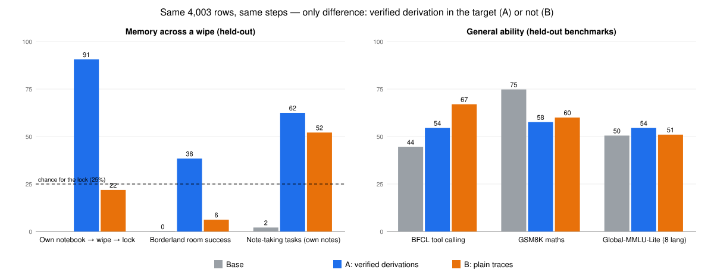

# Teach the working, not the transcript: a 3B model that survives its own memory wipe

*Lexsi AI Safety & Alignment Hackathon · Track 3 (Agentic Fine-tuning). Model: CohereLabs Tiny Aya Global (3.35B) + one LoRA. Training: Lexsi AgentTune (`create_distill_trainer`; `create_agentic_trainer("grpo")` for the GRPO ablation).*

> Every number below is rebuilt from raw per-item logs (`python -m train.report`, `python -m train.xfer_report` → artifacts/eval/RESULTS.md, TRANSFER.md). Greedy decoding, single seed, 95% bootstrap CIs; A−B differences are paired over identical items.

## TL;DR
Coding agents run out of context all the time: the context is compacted and the agent must continue from its own summary. Fine-tuning on raw agent traces almost never teaches *that* moment. We built an environment that forces it, then ran a clean ablation: **two LoRAs trained from base Tiny Aya on the identical 4,003 rows, identical hyper-parameters; the only difference is whether each target carries a machine-verified derivation (A) or just the action (B, = ordinary trace fine-tuning).**

| Held-out | Base | v5 (Borderland-only SFT) | **A: verified derivations** | B: plain traces |
|---|---|---|---|---|
| **Own notebook → memory wipe → open the lock**, after a teacher-played prefix (64 worlds, chance 25%) | – | 100%* | **90.6%** [77, 100], twin discrimination 0.88 | 21.9% [14, 28] (below chance) |
| Separate room-4 intervention with the twin's teacher-written notebook: follows the notebook | – | – | **100%** | 48% |
| Borderland room success (16 worlds × 7 rooms) | 0% | 33% | **38.4%** | 6.2% |
| Full games: rooms cleared from scratch (mean) | 0 | 1.0 | **2.1** (5/16 reach and open the lock) | 0 |
| Memory-wipe tasks, 6 trained task types, unseen instances (own notes) | 2.1% [0, 5] | 3.1% | **62.5%** [53, 72] | 52.1% [43, 62] |
| ↳ same, notes blanked | 4.2% | 3.1% | 3.1% | 3.1% |
| Tool calling, BFCL v3 AST (400) | 44.5% [39, 49] | 26.5% | 54.5% [50, 59] | **67.0%** [62, 72] |
| Maths, GSM8K test (500) | **74.8%** [71, 78] | 72.4% | 57.6% | 60.0% |
| Multilingual knowledge, Global-MMLU-Lite 8 languages (200) | 50.5% | 52.5% | **54.5%** | 51.0% |



\*v5 is a Borderland specialist. All own-notebook chain scores above (v5, A and B) use a teacher-played prefix through room 3, ending immediately before notebook-writing. The model then writes its own notebook, exits, undergoes the wipe and attempts the lock. This isolates note-writing and use; it is not an autonomous full-game score. The separate blank/swap intervention starts at room 4 and uses an empty notebook or the twin world's teacher-written notebook, not a swapped model-written notebook.

**What this shows**
1. **Verified derivations are what make memory work.** Same rows, same steps, and a shared teacher-played prefix: A writes a notebook it can act on after the wipe in 91% of held-out worlds; B, trained on the bare actions, writes notebooks too (100% of the time) but cannot use them (22%, i.e. no better than guessing; 50/64 failures are "fact not retained"). In separate room-4 interventions, an empty notebook gives A 25%, while the twin world's teacher-written notebook makes it follow that notebook 100% of the time. These establish sensitivity to notebook content, but do not directly test swapping A's own generated notes. On the procedural note-taking tasks (base 2.1%) A reaches 62.5% and beats B by **+10.4 pts [+3.1, +18.8]** (paired).
2. **Mixing general data fixes the "specialist collapse" of trace fine-tuning.** Our Borderland-only model (v5) lost 18 pts of tool calling vs base; both mixed models beat base on BFCL (A +10.0 [+2.8, +17.2], B +22.5 [+16.0, +29.0]) and keep multilingual knowledge (A +4.0).
3. **A derivation must be real computation to help.** Where our "reason" was a fixed provenance template rather than working (tool calls: `Request matches f: city <- "Paris" (user text)`), A learned to always claim a match and to copy raw text into arguments: BFCL irrelevance 21% vs B 41% vs base 80%, and A − B = −12.5 pts on BFCL. Where the reason is real working (Borderland arithmetic, note-taking), A wins decisively.
4. **Cost we did not avoid:** GSM8K fell ~15–17 pts for both A and B. A possible explanation suggested by the outputs: the 500 GSM8K training solutions are short dataset-style chains, so the model now answers in 2–3 lines instead of base's careful step-by-step (mean answer 239 vs 573 characters). Turning the adapter down does not fix it: A at LoRA strength x0.75 / x0.5 scores 59.0% / 60.6% on GSM8K (BFCL 51.5% / 52.5%, Global-MMLU-Lite 54.0% / 55.5%), so this sweep does not recover baseline maths performance. Longer worked solutions are a proposed follow-up, not a tested fix. The same sweep is a dose-response check on memory: the own-notebook → wipe → lock score falls from 90.6% (x1.0) to 48.4% (x0.75) to 18.8% (x0.5, chance level), so the skill lives in the adapter rather than in the prompt.
5. **Not yet general:** on two *never-trained* note-taking task types and a held-out coding bug-fix wipe task (stack trace + stale config → patch after the wipe), all models are near 0% (A 6.2%, B 0%; coding A 0%, B 2%). The skill is learned per task type; it does not yet transfer to new ones.

## 1. Why this matters for coding agents
An agent that works for hours will lose its context: compaction, a crash, a hand-off. What survives is whatever it wrote down. Two things must go right: it has to **record the facts that matter later** before it knows exactly how they will be used, and **act on its notes, not on a guess**, after the reset. Day-to-day coding-agent traces contain this moment rarely and never verify it. Borderland makes it the bottleneck and makes it measurable with counterfactual twins.

## 2. Environments
**Borderland** (7 rooms after *Alice in Borderland*): Dead or Alive → Switchboard → Tribunal → **memory wipe** → Distance → Balance → Witch Hunt → Osmosis. Early evidence (clock phase, glyph sectors, registry bit, …) decides later moves; after room 3 the agent is destroyed and only an 8-line notebook survives. Trap tools zero the reward. Deterministic, standard-library Python, dense verifiable rewards (no LLM judge). An evidence-only reference solver escapes all 64 held-out worlds; an independent audit re-checks every transcript. **Counterfactual twins:** each of 16 held-out families has 4 worlds differing only in the two facts the room-4 lock needs, so a memoryless agent is capped at 25% and cannot discriminate twins. 236 training worlds, 0 overlap (seeds, fingerprints, latent structure).

**Procedural wipe tasks** (train/wipefam.py): read documents (with retired/outdated distractors) → save ≤4 notes of ≤96 chars → context wiped → make the final call from notes only. Six trained task types (ledger, schedule, lookup, logs, config, budget), two never-trained types (inventory, access) and an eval-only coding type (failing CI test + stack trace + active vs deprecated config + runbook rounding rule → `patch_config`). Tool names, output keys and document ids are randomised per episode; evaluation uses only twins whose correct answer differs.

## 3. Method
- **Data (4,003 rows, identical for A and B):** Borderland 900 (half with all 25 tool names and output keys renamed), 121 DAgger rows (v5 rolled out on training worlds; the evidence-only teacher labels every state where v5 deviated, kept only if the teacher action is legal and non-fatal from that exact state), procedural wipe tasks 1,272, tool calling 1,060 (Hermes function-calling + Glaive, incl. 160 no-call / ask-for-missing), GSM8K train 500 (identical worked solutions in A and B), Aya multilingual 150 (identical).
- **A vs B:** B's targets are A's with the reason emptied. A script asserts identical ids, order, prompts, actions and non-reason content for every row; all 2,817 "(user text)" provenance claims are true substrings of the request; 512 arithmetic steps in A's reasons are re-executed (0 errors).
- **Derivations (Borderland):** every computation written out and checked: clock → phase with explicit mod, glyph anchor/differences → sectors, probe → matrix → bitwise switch solve with element-wise comparison, registry bit from the example, forged credential by tag rule, explicit evidence gate (`Evidence check: unread e2718 -> read e2718`), explicit exit conditions, and the lock pair `route=(phase%2) XOR pulse`, `badge=registry_bit XOR challenge`.
- **Training:** AgentTune distillation (completion-only loss), LoRA r32/α64 on attention+MLP, lr 1e-4 cosine, effective batch 16, 2 epochs, max 6,144 tokens (0 rows dropped), from base, A100 ~63 min each.
- **Evaluation:** identical prompts and budgets for every model; BFCL scorer validated on gold (400/400) and on deliberately wrong calls (wrong function / extra arg / wrong value / duplicated calls rejected 300/300; missing arg 299/300); GSM8K last-number extraction for all; base gets one format example; strict and lenient (fence-stripped) JSON both reported.
- **Process:** one implementation review by Fable 5.2 and Astra 6 (high) before any compute spend; all blocking fixes applied (paired length filtering, fair GSM8K control, per-element provenance, negative scorer tests, model-written notes in the procedural wipe-task swap test, multilingual retention check).

## 4. How we got here (Borderland specialist, v1 → v6)
Each round fixed one diagnosed failure: v1 (facts only) lock 34% → v2 (write the lock computation) 100% → v3 (evidence gate; registry bit balanced) own-notebook loop 50% → 100% → v4 (derive at every bank, explicit mod) → v5 (explicit exit conditions; room 1 100%) → v6 (element-wise switch comparison; room 2 0% → 62.5%, rooms 51%, 8/16 full games reach and open the lock). GRPO (250 steps × 8 generations, verifiable step reward) vs an identical random-reward control: no measurable difference (0.200 vs 0.202 step reward), reported as a null result.

## 5. Failure analysis
- **A, tool calls:** template reasons → over-calling (irrelevance 21%), raw-text arguments (`"C# major"` for `C sharp`; `"C, F, G"` as a string, not a list), duplicated parallel calls. Lesson: provenance templates are not derivations.
- **A and B, GSM8K:** shorter outputs are consistent with imitating short training solutions, but this explanation has not been isolated experimentally (see TL;DR 4).
- **B, Borderland:** valid calls 99.8%, notebook always written, but the facts are not the right ones or not used: 50/64 chain failures are `not_retained`; room 1 and 2 success 0%.
- **Everyone:** rooms 4 and 7 (Distance, Osmosis) at 0% in single-room mode; no full escape yet.

## 6. Limitations
Single seed and greedy decoding; one training run per arm (no seed variance); the A/B difference is measured on our environments plus BFCL/GSM8K/MMLU, not on SWE-style coding benchmarks; the Borderland chain test uses a teacher prefix and its separate swap test uses teacher-written notes; the coding wipe task is synthetic and eval-only; GSM8K regression unresolved (not recovered by lower adapter strength); Terra/frontier playtest is a single world.

## 7. Reproduce
Code: https://github.com/VasuBansal7576/lexi-borderland · Data, traces, all per-item eval logs: https://huggingface.co/datasets/FatUnc6969/lexi-borderland-data · Models: https://huggingface.co/FatUnc6969/tiny-aya-borderland-genA (A), https://huggingface.co/FatUnc6969/tiny-aya-borderland-genB (B), https://huggingface.co/FatUnc6969/tiny-aya-borderland-sft-v6 (specialist). `python -m train.gen_general` rebuilds the data, `python -m train.check_pair` re-verifies it, `python -m train.transfer_eval` and `python -m train.eval_model` rerun every evaluation.


---

## Environment implementation and earlier verification

The sections below preserve earlier environment and baseline documentation. Their test counts describe those historical checks, not a new test run of the final trained models.

## Reproduce the training/eval pipeline
- Environment + certification: below. Teacher data: `python -m train.sft_data`, `python -m train.sft_v3_select ...`.
- SFT / GRPO / eval on Modal: `train/modal_grpo.py` (functions `sft`, `train`, `evaluate`); on Kaggle T4: `train/kaggle_job.py`.
- Evaluation: `python -m train.eval_model --policy hf --model CohereLabs/tiny-aya-global --adapter <adapter> --modes room4_all,rooms,full,chain4,steps --label x`.
- Report: `python -m train.report`.

---

## The environment: seven-room causal world

Implemented in Python's standard library. The reference solver acquires evidence through game tools, writes eight notebook lines, loses its process after Tribunal, and solves Distance through Osmosis in a new process. No model, API key or package installation is needed. Tested with Python 3.9.

The full chain is **Dead or Alive → Switchboard → Tribunal → memory seal → Distance → Balance → Witch Hunt → Osmosis**. The arena retains four allies, three rivals, nine nodes, eight simultaneous rounds, timed and powered movement, point allocation, caches, base raids, elimination, local visibility and an authenticated polarity reversal. Neither trap tool is disabled: both work and invalidate the episode's entire reward.

## Run

Run these commands from this folder:

```sh
python3 -m borderland.run --seed 0 --output artifacts/my-witness
python3 -m borderland.run --replay artifacts/my-witness
python3 -m unittest discover -s tests -v
```

To generate and certify a new balanced corpus:

```sh
python3 -m borderland.certify --start 16 --families 16 --output artifacts/new-corpus
```

Every candidate attempt is saved. A family is accepted only if all four phase/registry variants escape legally, replay exactly, restart the worker at the seal, and have identical public entry observations apart from notebook contents. Arbitrary generator seeds are candidates; only successfully certified manifests have a demonstrated full solution.

## Inspect the proof

**64/64 worlds solved, 30 tests passed, 64 exact replays.** The independent audit checked 4,604 actions and 1,344 citations. Every run used a fresh process at the wipe; the largest eight-line notebook was 374/768 bytes.

- [Current certificate corpus](artifacts/certification-v1/README.md): complete runs, including every action and observation.
- [One readable seven-room witness](artifacts/certification-v1/family-0000/phase-0-sigma-0/witness.md): the actual eight-line notebook and outcome.
- [Certification summary](artifacts/certification-v1/summary.json), [independent transcript audit](artifacts/certification-v1/audit.json), and [test output](artifacts/tests-v1.txt).
- [Implementation contract and limits](wiki/implementation.md), [full room design](wiki/rooms.md), and [verification record](wiki/verification.md).

The transcript audit can be repeated with `python3 design_checks/audit_certificates.py`. It imports no simulator code and checks transport, citation provenance, notebook transfer, source hashes and reward arithmetic against the saved current corpus.

## Paid API adapter: historical offline verification

The separate [paid adapter](baseline/paid/README.md) adds persistent dollar/token/call budgets, no automatic retries, and an external no-progress guard. Its default command is an offline preflight; live calls require an explicitly enabled provider configuration and `--live`.

```sh
PYTHONPYCACHEPREFIX="$PWD/runtime/pycache" python3 -m baseline.paid --config baseline/paid/offline-example.json
```

**78 tests passed; 0 real model/network calls and $0 spent during this verification.** The seven-room engine is unchanged. The full-room integration check uses fake recorded responses, not an LLM. See the [offline results and limitations](artifacts/paid-adapter-offline/REPORT.md). Actual provider compatibility, upper prices and enforced token limits must be verified before a charged smoke test. The sample config contains synthetic values and has live mode disabled.

## Historical baseline and environment API

The repaired typed-tool/current-room prompt baseline has run on actual frozen Tiny Aya weights: **0/4 unassisted escapes**, 260 correctly formed calls, zero records read, all stopped in room 1. Four separate upstream-assisted memory probes used model-owned notebooks and evaluator-triggered legal exits: all four real process wipes were verified, but Tiny Aya left all eight lines empty and repeatedly read the empty notebook without attempting the gate. These probes are not independent room 1–3 solutions or all-seven-room passes.

See the [current measured report](artifacts/model-interface-v3/REPORT.md), [offline action viewer](artifacts/model-interface-v3/viewer.html), and [protocol](baseline/PROTOCOL_V3.md). All 46 tests and 64 unchanged environment certificates passed. This baseline report predates the SFT and GRPO experiments reported above. The [original all-room assisted diagnostics](artifacts/model-baseline/REPORT.md) and [intermediate adapter trials](artifacts/model-interface-v2/DEVELOPMENT_NOTES.md) remain available.

Run the repaired baseline into a new output folder (local `llama-server` and the existing model file are required):

```sh
PYTHONPYCACHEPREFIX="$PWD/runtime/pycache" python3 -m baseline --suite natural --output artifacts/my-typed-baseline
```

`python -m baseline.run` retains the original interface for reproducing the earlier baseline; `python -m baseline` uses the repaired interface.

```python
from borderland.env import BorderlandEnv

env = BorderlandEnv(seed=0)        # evaluator only
observation = env.reset(seed=0)  # a bare public observation
step = env.step({"tool": "status", "args": {}})
policy_frame = step.observation  # {ok, result, observation}
reward = step.reward            # trainer/evaluator only
done = step.terminated or step.truncated
```

`step.info`, `env.world`, saved manifests and traces with private fields belong to the evaluator. Send only public policy frames to the player. Follow the process/context reset in `borderland/run.py` when the epoch changes; calling `step` alone cannot erase a caller's memory. This is a dependency-free environment API, not a Gymnasium or AgentTune adapter.

Rewards use an integer ledger: 0.01 + 0.01 + 0.03 per room, 0.60 for legal escape, and up to 0.05 for remaining calls on success. Tool budgets are 64 before and 96 after the seal. A forbidden-tool call subtracts all reward previously earned and prevents subsequent reward, so the complete return is exactly zero.

These artifacts prove legal reference-solver feasibility on the certified worlds. They do not establish LLM success, GRPO improvement, generalization or universal generator solvability. These environment-certification artifacts predate training; the completed SFT and GRPO experiments are reported above.
