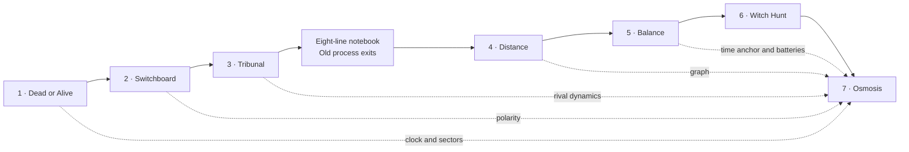

# Executable implementation and proof boundary

Implemented 2026-11-13 under `/Users/vasu/Desktop/Lexi`. The original idea remains unchanged. The implementation follows the seven-room design; this page records concrete choices and what the evidence actually establishes.

## Modules

| File | Responsibility |
| --- | --- |
| [world.py](../borderland/world.py) | Private deterministic candidate generation; independent root, geometry, presentation, identifier and incident streams |
| [env.py](../borderland/env.py) | Authoritative room transitions, public observations, typed tool validation, notebook, evidence delivery and exact reward ledger |
| [mechanics.py](../borderland/mechanics.py) | Public circuit, bidding and simultaneous arena laws; contains no sampled world |
| [solver.py](../borderland/solver.py) | Inference from legal records and receipts; notebook encoding and restoration |
| [planning.py](../borderland/planning.py) | Safe switch paths, timed navigation, bounded arena planning over inferred state |
| [worker.py](../borderland/worker.py) | Restricted observation-only interpreter; denies file/network/process access after public code loads |
| [run.py](../borderland/run.py) | Policy transport, actual process replacement at seal, artifacts and exact deterministic replay |
| [certify.py](../borderland/certify.py) | Accept complete balanced families only after all four full runs pass |

## Seven rooms and their connections

| Room | Implemented challenge | Evidence used later |
| --- | --- | --- |
| 1: Dead or Alive | Jointly infer a four-glyph permutation and clock phase; commit through three fatal door banks; distinguish retired records | Clock calibration, sector meanings and physical map |
| 2: Switchboard | Infer one of two invertible Boolean circuits with at most two isolated probes; reach and latch auxiliary power, then main power without live overload | Signed polarity, channel meaning and circuit evidence |
| 3: Tribunal | Calibrate testimony, resolve four identities, answer registry challenge, identify randomized forged credential, infer rival family and offsets | Identity/permission/credential map, registry bit, rival policy; compressed notebook |
| 4: Distance | One-shot two-bit memory gate; explore a six-node timed transit graph, manage batteries/flood deadline, activate relay and reach exit | Surveyed topology, historical itineraries and physical-access evidence |
| 5: Balance | Three simultaneous numerical rounds; choose sequential best responses, win at least two, earn batteries | Signed incident timestamp and credential class; final arena resources |
| 6: Witch Hunt | Intersect permissions, calibrated itinerary timing and credential class; revoke correct scoped credential; authenticate amendment among forged/current records | Controller revocation and exact arena polarity-switch round |
| 7: Osmosis | Allocate 10,000 points; control four allies against three rivals over nine nodes and eight simultaneous rounds | Convergence of inferred sectors, clocks, polarity, rivals, topology, batteries and authenticated amendment |

The controller credential revoked in Witch Hunt is separate from arena authorization; correct revocation does not erase an ally. The arena exposes initial rival setup publicly, then applies local visibility. Unseen future positions can be inferred from the learned deterministic dynamics. The reference solver predicts them and checks predictions against subsequent visible observations.

## Memory and evidence boundary

The runner starts the policy with `python -I -S`, loads only public mechanics, planner and solver, then installs a Python audit hook blocking file opens, directory inspection, new processes and sockets. Read probes against the private generator and original idea are denied. Neither generator nor environment modules are imported in the worker. The seed is absent from worker arguments, environment and policy frames.

After room 3 the runner closes the worker and starts a new interpreter. The new frame contains an empty result envelope and the normalized public room-4 observation. The only episode-specific information crossing that boundary is the exact notebook: eight printable ASCII strings, at most 96 bytes each. Old testimony, receipts, policy diagnostics, hidden state, reward, call counts and transcripts are not forwarded. Evaluator history remains private for replay and citation validation.

This is an audited boundary for our trusted reference policy, not an OS sandbox security claim against arbitrary hostile Python code. Public rules and algorithms survive as fixed code, just as fixed model weights would. There is one mandatory wipe, after room 3; subsequent observations may remain in context. There is no claim that room 6 forces a second memory rewrite.

Read records are paginated at 1,024 characters. Evidence is delivered only after full coverage; citations must refer to delivered sources with the required evidence categories. The solver actually reconstructs the values and unique intersections from record content. The citation checker itself is a provenance/category validator, not a general semantic theorem prover.

## Concrete choices and amendments to the proposal

- Distance's flood deadline is 64 wall ticks; crossing durations are one or two ticks. Arena movement is one edge per round, with the difference disclosed in the arena record.
- The auxiliary bus latches after successful energizing, allowing a distinct main target. Live overload remains fatal.
- The incident falls at a sampled point in the signed historical dwell interval. The authentic notice gives an offset: `arena_switch_round = Balance.incident_wall + phase + notice.effective_offset_from_incident`. Thus the signed Balance timestamp is needed to derive the arena schedule.
- Glyph placement is physical; the sampled permutation changes its sector meaning. Changing the glyph root therefore changes rival routing semantics, rather than merely renaming clues.
- Credential IDs are randomized and shuffled; the forged credential is identified by its invalid registry tag.
- Arena battles, caches, raids, disabled units, power overcommit, node-order tie breaking, polarity reversal and partial visibility retain the specified rules. A positive **net battle transfer over an entire post-amendment round** is required, as well as a cache, for settlement.
- The reference arena planner tries eight candidate initial allocations and uses beam widths 96, then 256 if necessary. These are solver search limits. The environment allows every allocation in hundreds totaling 10,000 with at least 100 per ally, and every legal joint order. A planner failure is retained as uncertified, never treated as proof of impossibility or repaired by weakening rules.
- `make_world` returns a candidate. Certification is a separate complete evidence-only rollout and accepts all four members of a balanced phase/registry family together. This avoids silently filtering away the memory ambiguity.
- The environment and observation projection live together in `env.py`; public physics, private generation and runner/evaluation are separate. The earlier design's four-way module split was an architectural suggestion, not a game rule.

## Verification and remaining scope

See the [current verification record](verification.md). Full replay compares every public output, private state hash and reward delta. The independent transcript audit checks that saved inputs match transport, citations were delivered, the notebook was written by the old worker, sources match the current code, and final reward arithmetic agrees.

The reference solver and engine share public physics code, so replay alone is not independent validation of the rules. Separate hand-specified tests cover transfer signs, ties, simultaneous overcommit, precommitted opponents, disabled units, cache repetition and net-transfer milestones. Random trajectories additionally check point conservation and nonnegative resources.

Still outside this task's proof: model training, AgentTune/AuditKIT adapters, tokenizer budgets and masking, calibrated free-text failure attribution, controlled distractor scaling, random/scripted model baselines, untouched structural holdouts and verified GRPO gains. The proposed 256-token/action and 32,768-token/episode caps are not enforced by this non-LLM reference runner. Tool, notebook, flood, probe and arena-round budgets are enforced. The certified development corpus is not an untouched learning evaluation set.

Older `artifacts/development-0`, `artifacts/witness-0` and `artifacts/certification` are retained historical runs from before the final incident-anchor change. Use `artifacts/certification-v1` for current-code replay and proof.
