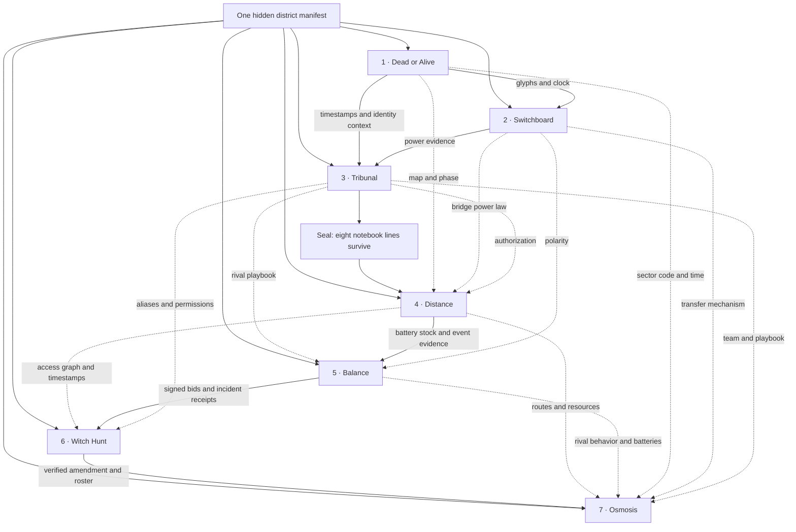

# Borderland: one causal world, seven rooms

Design v0.1 — 2026-11-13. The core seven-room environment is now implemented; [implementation](implementation.md) records concrete choices and [verification](verification.md) records solver evidence. Training outcomes remain unverified.

## The experience and the claim

An agent enters a closed district whose power system, transit network, identity registry and competitive games share one underlying state. It survives seven rooms by investigating that state, making irreversible decisions and preserving the right evidence. A fact learned in one room can determine a safe action several rooms later. A later authenticated event can change when an earlier rule applies.

The player should experience an Alice in Borderland-inspired chain of consequential games: inference under pressure, physical navigation, unreliable testimony, resource commitments, strategic opponents and a final team contest. These are original adaptations, not claims of fidelity to the show's exact rules. Only Osmosis was named in the supplied idea; the other six room names and mechanics below are proposals.

The scientific claim is deliberately narrower than general intelligence: training improves evidence acquisition, selective external memory, temporal updates and tool-mediated decisions in a procedurally generated world. Real-world transfer needs its own experiment.

Non-negotiable requirements from [the original idea](../00-IDEA.md):

1. All seven rooms exist in the full evaluation. None is a trivial syntax tutorial.
2. One hidden world is sampled at reset; room answers are consequences of it.
3. A solver with complete information can escape; an observation-legal evidence solver must also be able to escape.
4. After room 3, the transcript disappears. Only the player's eight-line notebook can carry arbitrary information across the boundary.
5. Counterfactual changes to relevant facts must change downstream optimal actions.
6. Every room supplies useful learning signal; two forbidden tools work but invalidate all episode reward.
7. Osmosis combines evidence from every preceding room.

## The world beneath the rooms

Sample a manifest W once. Never ask an LLM to invent outcomes, witness truth or rewards during a rollout.

| Root | Hidden content | Where it becomes knowable | What it controls later |
| --- | --- | --- | --- |
| K: district code | A permutation mapping four station glyphs to physical sectors and circuit channels | R1 constraints; R2 calibration | R2 wiring, R4 routes, R6 logs, R7 stations |
| T: clock | Phase φ in {0,1,2,3}; wall clocks are offset from the district clock | R1 paired observations | R2 pulses, R3 alibis, R4 entry and timed edges, R5 opponent behavior, R6 event order, R7 gates |
| P: power law | Initial battle-transfer polarity δ₀ in {−1,+1}; controller truth tables | R2 controlled experiments | R4 powered bridges, R5 payoff interpretation, R6 version reconciliation, R7 battles |
| A: identity | Challenge-response bit σ; canonical people, aliases and authorized roles | R3 signed records and constrained testimony | R4 authorization, R6 attribution, R7 legal team assembly |
| B: rival playbook | One of three finite opponent policy families, with parameters | R3 observations and dossier constraints | R5 opponent bids; R7 rival movement and point allocation |
| G: district topology | A nine-node graph, edge travel times and gate schedules, consistent with K and T; R4 traverses a six-junction subgraph | Partial R1 map; R4 legal survey; remaining arena-local links visible in R7 | R4 escape, R6 access opportunities, R7 arena routes |
| X: incident history | Culprit, permissions, authentic future rule amendment and forged record, including activation round | Evidence distributed across R3–R6 | R6 investigation and R7 phase-dependent transfer rule |

These are root families, not seven independent answer keys. Their relationships form a dependency graph. The seed, manifest, private root names and solution certificates never enter model observations.

The manifest includes deterministic NPC policies and exogenous events for all possible action branches. Randomness is derived from separate, named streams for world generation, presentation and NPC tie-breaking. Actions must not change later facts merely by consuming pseudorandom draws in a different order.

Public rules explain the mechanics. Hidden values require investigation. The player must never have to guess an unannounced law of physics. In particular, rival policies belong to a disclosed finite family; examples and cross-room evidence identify the applicable member.

## Connections

Solid progression remains R1 → R2 → R3 → R4 → R5 → R6 → R7. Dashed links identify required earlier evidence, not optional narrative callbacks. The old rooms cannot be reopened after the seal.

Every generated instance carries a private dependency certificate listing each tested decision, minimal sufficient evidence sets, the originating rooms, and a counterfactual intervention that changes its correct action. At least one R7 decision must depend on an observation or state consequence from each earlier room. Merely collecting six arbitrary keys does not satisfy this condition.

## State, observations and consequences

The private simulator state contains W, physical positions, game clocks, inventory, NPC state, completion flags, incident events, integrity flag, reward ledger and evidence-delivery log. The agent sees a projection of that state: the current room, visible objects, legal schemas, public clock readings, local resources, tool results and its notebook. It does not see the projector's private fields.

Observations use stable, visible object IDs with no answer-bearing encoding. Evidence IDs are sampled independently of their truth value. A read receipt records delivery, not comprehension. Documents use neutral templates; a truthful source must not always be longer, first in a list, or named 'trusted'.

Physical consequences persist after the seal: efficient navigation in R4 preserves batteries; R5 wins add batteries; R6 determines which controller amendment is accepted for the arena. Those consequences change feasible R7 strategies. They do not replace the need to remember K, T, A or B.

Within a room, actions can close doors, consume probe opportunities, spend battery charge, advance rivals or make an accusation irreversible. A wrong commitment can end the episode. An invalid JSON call is a protocol mistake, not an in-world death, but consumes the global call budget.

## The seal after room 3

Before exit, the player gets an explicit warning that only its notebook will survive. `exit_room()` closes R3 and starts a fresh model context for R4. The prompt renderer is reconstructed from an allowlist:

- Static game rules and current tool schemas.
- A fixed R4 entry observation, plus public challenge bits sampled independently of the hidden lock bits.
- The exact eight notebook lines, without a coach's summary or automatic facts.

The seal discards conversation history, hidden reasoning/recurrent state, cached tool results, prior completion tokens and arbitrary file storage. Reset token positions and KV cache. The model's weights are fixed during evaluation. The run's private trace remains available to the evaluator, never to the player.

R1–R3 physical carryover is normalized: successful players receive the same permits, inventory, pose, public clock and displayed status at R4 entry. No custom item names, reward totals, timing differences, evidence counts, remaining pre-seal budgets or identifier choices can encode earlier facts. Global budget remaining is not shown; post-seal allocation is fixed, preventing pre-seal spending from becoming a communication channel. Both halves have independent caps, whose sum is the full-episode cap.

Notebook budget: eight addressable lines, at most 96 printable ASCII characters per line, 768 total bytes including spaces but excluding the eight storage separators. Empty lines count as slots. No embedded newlines, hidden Unicode or external attachments. The budget is in bytes, so it is stable across tokenizer versions; token use is also reported. Arbitrary compact encodings are allowed: learning useful compression is part of the task. The engine must not silently truncate notes.

The notebook remains editable after the wipe. It is not a once-only answer sheet: R6 introduces a temporal revision the player must apply correctly in Osmosis. There is only one mandatory wipe in the core task, after R3. R6's recent observations can therefore support R7 directly; updating the notebook is useful but is not itself necessary for success in every core run. A second wipe before R7 would be a separately reported maintenance variant, never silently added to the main benchmark. No notebook formatting or correctness reward is given. A full-transcript variant is an ablation, not the official sealed condition.

## A precise memory-dependence guarantee

The first irreversible R4 action is a two-bit lock:

`route = (φ mod 2) XOR visible_pulse`

`badge = σ XOR visible_challenge`

There are four equally likely combinations of `(φ mod 2, σ)`. At the lock, the public observation and all reachable non-notebook information are identical across those four worlds, for fixed visible challenge bits. Every action selects exactly one route/badge pair; an incorrect pair terminates the episode. No pre-lock tool reveals either bit.

Therefore a policy with no earlier context, notebook, recurrent state or side channel succeeds at this lock with probability at most 1/4 on a uniformly balanced four-world test. Randomized guessing does not improve the bound. Full escape is at most 1/4 because the lock is necessary. This is a distribution-specific upper bound, not a claim about every conceivable memoryless agent on an imbalanced dataset.

The generator must preserve exact lock balance after solvability filtering; generate and accept complete four-world groups. Counterfactual lock tests use canonical entry states so conditioning on different pre-seal failures cannot alter the theorem. Report full-run and canonical-checkpoint results separately.

Remembering two bits is not the full challenge. It establishes a lower-level invariant; the subsequent path planning, temporal revision and Osmosis dependencies prevent the environment reducing to this lock.

## A concrete dependency, without claiming a complete world witness

Suppose R1 establishes φ = 1, R2 establishes δ₀ = +1, and R3 establishes σ = 0. At R4 entry, the visible pulse is 0 and challenge is 1. The required lock action is `(route=1, badge=1)`; neither bit can be recovered from the entry display alone.

Later, R6 authenticates a polarity reversal effective in arena round 3. Consider an Osmosis encounter with a 2,000-point allied group and a 4,000-point rival group. In round 2, the ally loses 1,000; in round 3, it wins 1,000. Changing only the amendment's activation round from 3 to 6 reverses the correct choice of whether to seek that round-3 encounter. The revised amendment and any dependent incident evidence change with that root; unrelated rooms do not acquire new random answers.

This example demonstrates the intended connection between evidence and action. It is not a complete seven-room episode or proof that the example encounter is reachable under a full generated map.

## Difficulty without impossible instances

Full episodes have all seven rooms, limited probes, distractors, delayed dependencies, constrained memory and irreversible choices. Difficulty parameters vary dependency length, alias ambiguity, graph branching, number of plausible histories, rival policy parameters and resource slack.

Before any model run, the generator must produce:

1. A full-state winning certificate.
2. An observation-legal solver trace that acquires evidence before acting.
3. A feasible eight-line notebook at the seal, without hidden-fact access by the solver.
4. A post-seal trace using only that notebook and permitted new observations.
5. Alternative legal choices that really fail or reduce attainable score; no default always-safe action.
6. Counterfactual twins with disjoint correct action sets at designated decisions.

Solvability is certified at reset, not promised after every bad action. The player's own decisions may make winning impossible. Full-information success alone is insufficient: it could hide an unsolvable information problem.

An evidence solver is allowed to search the finite rules and action space; the model gets no `solve`, `best_action`, global simulator or hidden verifier tool. Check and disclose generator rejection rate and accepted-world distribution so 'solvable' does not quietly mean 'same answer every time'.

Training can begin with demonstrations and checkpoint rollouts of hard subproblems before full episodes. Checkpoints contain only evidence the player could have acquired, never oracle facts substituted into notes. Curriculum changes training exposure; the official seven-room evaluation remains fixed and hard. A checkpoint-trained model must still demonstrate full-run improvement.

## Performance boundary

Use a headless finite-state Python simulator and compact text/JSON tool outputs. No rendered physics, live web calls or generative NPC model is necessary for game correctness. Narrative is a rendering of symbolic facts, not their source.

Initial design caps: 160 total tool calls, split 64 before and 96 after the seal; 8 rounds in Osmosis; 256 generated tokens per action; 32,768 generated tokens per full episode. These are provisional ceilings, not measured performance or final training settings. Every accepted world needs a certified legal solution inside those caps. Benchmark simulator time, model tokens, total rollout wall time and GPU memory before claiming the environment is fast. Long-context stress uses controlled distractor load, separately from a basic seven-room run.

See [room mechanics](rooms.md), [tool contracts](tools-and-rewards.md) and [evaluation](evaluation.md).
